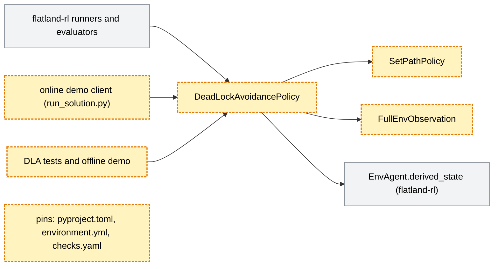
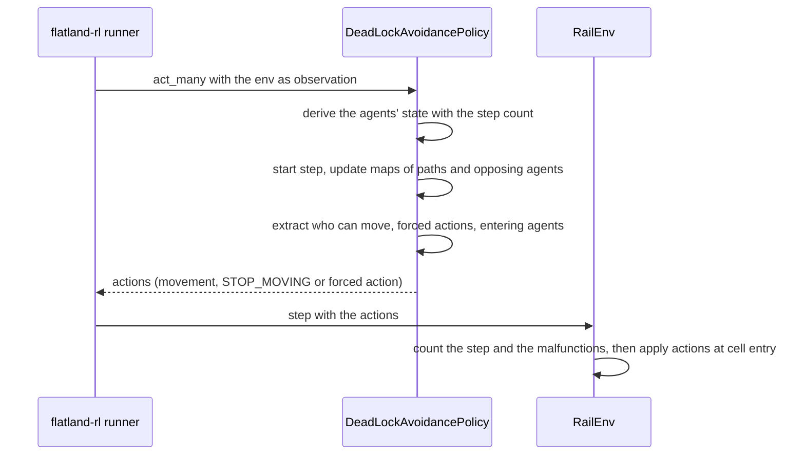

# Keep the baselines working with flatland-rl's "agents live on edges" redesign (flatland-rl#178)

> **Status:** plan of 2026-11-12, draft, written after the stack's commits (phases 1-7 done, review findings planned
> in phase 8). Based on `main` c1733cb (release 4.3.0) and
> flatland-rl [#541](https://github.com/flatland-association/flatland-rl/pull/541) (open, head c689b22f). Issue
> [flatland-rl#178](https://github.com/flatland-association/flatland-rl/issues/178) ("(D2) Remove Action Saver Class:
> agents live on "edges", actions are applied at cell entry", chenkins). Stack of seven PRs, top branch
> `178-agents-living-on-the-edge-19`, PR [#90](https://github.com/flatland-association/flatland-baselines/pull/90)
> (head 11887c7 at the last CI run, chain in §11.2). Open questions: none (§9.1). CI on ffd2477 failed one test under
> pandas 3 (F-18), fixed in 4ef5ace (S-27); CI on 11887c7 passes.
>
> **Why:** flatland-rl 5.0 changes when actions apply, how agents enter and stop, and whether a plain environment
> tracks the agents' state. The baselines, above all the deadlock-avoidance heuristic (DLA), must keep running
> and keep their benchmark results explainable at every step of that upstream series.

## 1. Introduction and goals

*What the change is for: the requirements, the qualities that matter, who has a stake, and what it leaves out.*

### 1.1 Requirements overview (functional requirements)

*The issue's text and the numbered requirements the rest of the plan refers to.*

> flatland-rl#178: Remove Action Saver Class: agents live on "edges", actions are applied at cell entry.

The stack follows the upstream PRs one by one: flatland-rl
[#501](https://github.com/flatland-association/flatland-rl/pull/501) (D2.3),
[#505](https://github.com/flatland-association/flatland-rl/pull/505) (D2.3c),
[#509](https://github.com/flatland-association/flatland-rl/pull/509) (D2.7),
[#513](https://github.com/flatland-association/flatland-rl/pull/513) (D1\*),
[#515](https://github.com/flatland-association/flatland-rl/pull/515) (D5/6),
[#520](https://github.com/flatland-association/flatland-rl/pull/520) (optional state machine) and
[#541](https://github.com/flatland-association/flatland-rl/pull/541) (state machine setting kept on reload, open).

Requirements:

- **REQ-1** The baselines run against each upstream step: imports, renamed symbols and interfaces follow flatland-rl.
- **REQ-2** DLA decides with the new action timing: an action decides the transition at the next cell entry, not the
  current one.
- **REQ-3** DLA never sends an agent onto a branch its path does not take, also when a crossing can no longer be
  stopped.
- **REQ-4** Entering prevention sees every agent that enters the map in the coming step, whatever shortcut the state
  machine takes.
- **REQ-5** DLA sees the agents' correct state wherever it runs: tests, offline and online demo, trajectory runners.
  Since Q-2 (2026-11-12) it derives the state itself, without requiring the state machine (S-31).
- **REQ-6** Every change of the expected results (golden values) is explained by a named upstream change.
- **REQ-7** Before the merge into `main`, the baselines depend on a released flatland-rl, so the package can be
  published to PyPI. Moved out of this PR on 2026-11-12 (§9.2): the pin to the released flatland-rl follows the merge,
  before release-please's release PR is merged (§1.4).

### 1.2 Quality goals (non-functional requirements)

*The few qualities the design must reach, each with a concrete scenario.*

| ID | Priority | Quality goal | Scenario |
|---|---|---|---|
| NFR-1 | 1 | Explainable results | A golden value changes only in a commit that names the upstream commit or PR causing it, found by running the old and new pin. |
| NFR-2 | 2 | Reproducible CI | CI checks out the same flatland-rl and episodes every run: pins are commit SHAs or release tags, not branches. |
| NFR-3 | 3 | Online equals offline | The online demo (Docker) and the offline demo give the same results, from the same constants. |

### 1.3 Stakeholders

*Who asks for the change, decides on it, reviews it or works with the result, and what they expect.*

| Role | Name | Expectations |
|---|---|---|
| Author, flatland-rl maintainer | chenkins | Each upstream step lands with a green baselines PR. |
| Benchmark users | Flatland Benchmarks (fab.flatland.cloud) | DLA containers keep working; result changes are explained. |
| Reviewers | flatland-association maintainers | Small PRs, each tied to one upstream PR. |

### 1.4 Follow-ups (not in this PR)

*What this PR leaves out, why, and where it goes later.*

| Follow-up | Why not in this PR | From | Findings | Issue |
|---|---|---|---|---|
| Pin the released flatland-rl 5.0.0 in all three places, after the stack is merged into `main` and before release-please's release PR is merged. | Waits for flatland-rl#541's merge and the 5.0.0 release; moved out of this PR on 2026-11-12 (formerly S-37). | REQ-7 | F-2, F-16, F-17 | untracked |
| Record the 50 benchmark episodes again with the current engine and replay them in the tests. | Needs a new archive in flatland-scenarios (another repo) and a review of the new results. | §2.1 (TODO) | F-5 | [#94](https://github.com/flatland-association/flatland-baselines/issues/94) |
| Apply the alternative path DLA picks when an agent is blocked, planned from the settled next entry point. | Fails on `main` too; applying it changes DLA's results and needs its own calibration. | §2.1 | F-9 | [#93](https://github.com/flatland-association/flatland-baselines/issues/93) |
| Redesign DLA to need no train state, as preparation for the observation builder extraction ([#65](https://github.com/flatland-association/flatland-baselines/pull/65)). | A redesign; this PR only needs DLA to get the state right (Q-2). | Q-2 | F-14 | - |

## 2. Constraints

*What limits the design from outside: platform, organisation and conventions.*

| ID | Constraint | Kind | Explanation |
|---|---|---|---|
| C-1 | flatland-rl is pinned in three places | convention | `pyproject.toml`, `environment.yml` and `checks.yaml`'s `env.flatland-rl-ref` move together (`# DEPENDENCY SWITCH`, `CLAUDE.md`). |
| C-2 | No direct git dependency on PyPI | technical | PyPI rejects a package whose dependencies are direct URLs (`pyproject.toml:24-26`). |
| C-3 | release-please publishes when its release PR is merged | organisational | `.github/workflows/release-please.yml`: every push to `main` updates the release PR; merging that PR publishes to PyPI, which fails while `main` carries a git pin. |
| C-4 | Upstream branches are deleted after their merge | organisational | All `178-agents-living-on-the-edge-*` branches of flatland-rl are gone; pins by branch name break. |
| C-5 | Python 3.11-3.14 | technical | flatland-rl 5.0 requires Python 3.11 or newer. | 

### 2.1 Limitations

*What the built code gets wrong or ignores, each with the TODO or issue that tracks it.*

Limitations (DLA's own list: `flatland_baselines/deadlock_avoidance_heuristic/README.md`, "Limitation" and "Known
weakness", and `CLAUDE.md`, "Known limitations"):

- The 50 recorded benchmark episodes are not replayed: the test is skipped
  (`tests/test_episodes_deadlock_avoidance.py:15`, TODO referring to #94). §1.4, F-5, [#94](https://github.com/flatland-association/flatland-baselines/issues/94).
- DLA picks an alternative path for a blocked agent but never applies it (`_find_alternative`, on `main` too).
  §1.4, F-9, [#93](https://github.com/flatland-association/flatland-baselines/issues/93).
- `SetPathPolicy` on its own fails on an agent on the map: it calls a flatland-rl method that is private since 4.3.0.
  F-8, S-30.
- The DLA limitations documented before the stack stay (free space filled by other trains, two switches facing
  each other, loopy paths).

### 2.2 Assumptions

*What must hold for the design to be correct, but is not checked in code.*

Not checked in code; they hold by construction of the test setups and of flatland-rl's step order.

- DLA reads the agents' state between two steps, where flatland-rl documents `derived_state(elapsed_steps)` as equal
  to the tracked state (`agent_utils.py`, `derived_state`). Until S-31, the env must run the state machine instead
  (Q-2).
- flatland-rl decrements the malfunction counter and increments the step count before it reads the state
  transition signals, as at b99bfd11 (`rail_env_state_machine_wrapper.py:100-122`). Entering prevention mirrors that
  order.
- The online and offline demos run the same episodes with the same seeds, so they can share their expected values.
- GitHub's stack merge is available for the repository when the stack is merged (Q-3); the docs mark it as a
  public preview on GitHub Enterprise Cloud.
- flatland-rl#541 is merged before the stack, so S-38 can pin its merge commit on flatland-rl's `main`, which stays
  fetchable after #541's branch is deleted, until the follow-up pins flatland-rl 5.0.0 (§1.4).

## 3. Context and scope (checked 2026-11-12 on `main` c1733cb)

*The code on the base branch that the change works in, as it is before the change, and where the change stops.*

Context on `main` (pinned to flatland-rl 4.3.0):

- `deadlock_avoidance_heuristic/policy/set_path_policy.py`: `SetPathPolicy` keeps one fixed shortest path per agent
  and acts toward its next waypoint from `agent.current_configuration`.
- `deadlock_avoidance_heuristic/policy/deadlock_avoidance_policy.py`: `DeadLockAvoidancePolicy` runs a check per
  step (`_start_step` → `_extract_agent_can_move` → `_check_agent_can_move`) and sends `STOP_MOVING` to an agent that
  has too few free cells before an opposing agent. Entering prevention (`use_entering_prevention`) compares the
  `READY_TO_DEPART` agents only.
- `observation/full_env_observation.py`: `FullEnvObservation` returns the whole env (`ObservationType`).
- `online_demo/`, `offline_demo/`: the same expected values (golden values) for the online (Docker) and offline
  evaluation.
- Tests: hand-built envs (`test_entering_prevention.py`, `test_limitations_*.py`), CLI end-to-end runs
  (`test_policy_runner.py`, `test_policy_grid_runner_evaluator.py`) and the replay of recorded episodes
  (`test_episodes_deadlock_avoidance.py`).
- CI (`checks.yaml`): flatland-rl at `v4.3.0`, episodes archive v5 from flatland-scenarios `main`, Python 3.10-3.14.

Scope: the stack changes DLA, `SetPathPolicy`, `FullEnvObservation`, the online demo's client, the tests, CI and the
pins. The simple baselines (`do_nothing`, `forever`, `forward_only`, `random`) and the Dockerfiles stay as they are.

## 4. Solution strategy

*The fundamental choices and why, the rules the design follows, how it is verified, and the design of each part.*

| Quality goal | Scenario | Solution approach | Details |
|---|---|---|---|
| NFR-1 Explainable results | A golden value changes | One baselines PR per upstream PR; each recalibration names its cause, found by testing the old and new pin. | §4.3, §4.9 |
| NFR-2 Reproducible CI | Same inputs every run | Pin flatland-rl by commit SHA (branch name as a comment), the episodes by a commit (S-33), the release by tag (follow-up, §1.4). | §7, §11.2 |
| NFR-3 Online equals offline | Shared constants | Keep the online demo importing the offline demo's expected values. | §4.9 |

### 4.1 Design principles

*The rules the design follows, each with its decision, the concepts it reuses instead of building new ones, and what
is not new on purpose.*

- **DP-1 Follow upstream, one PR per upstream step.** Each baselines PR pins one upstream state and only adapts to
  it. (decision of 2026-08-18)
- **DP-2 A recalibration names its cause.** Expected values change only with the upstream change that moved them,
  located by running the tests on both sides of it. (decision of 2026-08-25)
- **DP-3 DLA reads the engine, it does not re-implement it.** Where DLA must predict the engine (entering,
  crossings), it mirrors the engine's own conditions and says where they come from. (F-3, F-4)
- **DP-4 DLA derives the agents' state itself.** It reads `derived_state` with the step count, so it works on any
  env, with or without the state machine (Q-2, S-31; until then the caller turns the state machine on).
- **DP-5 No branch pins.** Pins point at commits or tags, so a deleted branch can't break CI. (decision of
  2026-10-14)

Reused concepts:

| Need | Reused concept | Instead of |
|---|---|---|
| The agents' state for DLA | flatland-rl's `EnvAgent.derived_state(elapsed_steps)` (S-31; until then `RailEnvStateMachineWrapper`) | a DLA-side state tracker, or requiring the state machine |
| Turn the state machine on in runners (until S-31) | flatland-rl's `--skip-state-machine-update False` option (flatland-rl#541) | patching envs after loading |
| Steer an unavoidable crossing | DLA's own action toward its set path (`_get_action`) | a second path planner |
| Pin flatland-rl | the three `# DEPENDENCY SWITCH` places | a new requirements file |

Not new on purpose: no new policy class, no new CLI option, no new episode format; the Dockerfiles and the simple
baselines stay as they are.

### 4.2 Verification

*How each requirement and quality goal is shown to work: tests, CI checks, before and after screenshots.*

Screenshots: none, nothing is visible. Checks run locally against flatland-rl at the pin (extracted tree on
`PYTHONPATH`) and in CI (`checks.yaml`).

| ID | Requirement | Test or check | Result | Screenshots |
|---|---|---|---|---|
| REQ-1 | Runs against each upstream step | `pytest flatland_baselines/deadlock_avoidance_heuristic/tests` per PR, CI per PR | ✅ CI on 11887c7, Python 3.11-3.14 (pandas 3). At ffd2477 CI failed `test_gen_trajectories_from_metadata` on pandas 3 (F-18, fixed in 4ef5ace) | - |
| REQ-2 | New action timing | `test_limitations_*.py`, `test_intermediate_stops.py` | ✅ | - |
| REQ-3 | No wrong branch at an unavoidable crossing | `test_stop_moving_advances_full_speed_agent_into_trunk_edge9_regression` | ❌ the forced action also keeps blocked agents moving (F-1, S-28) | - |
| REQ-4 | Entering prevention sees every entering agent | `test_entering_prevention.py` | ❌ misses earliest departure 1 and is one step late after a malfunction (F-3, F-4, S-29) | - |
| REQ-5 | DLA sees the agents' correct state | now: grid runner test and offline demo with `--skip-state-machine-update False`, online client wrapped; after S-31: the same tests without state machine, unwrapped | ✅ now; S-31 checked in a scratch copy (Q-2) | - |
| REQ-6 | Recalibrations named | commit messages of 17d2c76, 1d1b4fd, 048ea5f, 49635a3, 46e74cb, 01322b0, be92953, ffd2477 | ✅ | - |
| REQ-7 | Released flatland-rl before `main` | `pyproject.toml` without a git URL | ⏭️ moved to the follow-up in §1.4 (2026-11-12) | - |
| NFR-1 | Explainable results | each recalibration commit names its cause (REQ-6) | ✅ | - |
| NFR-2 | Reproducible CI | flatland-rl pinned by commit SHA; episodes by commit (S-33); release tag (follow-up, §1.4) | 💡 episodes still by branch (F-6) | - |
| NFR-3 | Online equals offline | `online_demo/test_online.py` in CI | ✅ CI on ffd2477, Python 3.11-3.14 | - |

### 4.3 Phase 1: actions at cell entry (#80; REQ-1, REQ-2)

*One part of the change: what changes and why, with the requirements and decisions it implements.*

For flatland-rl#501.

- Renames: `*_configuration` → `*_entry_point`, `ObservationType` → `Observation`.
- `SetPathPolicy._act` and `_extract_agent_can_move` act from the pending next entry point toward the waypoint
  after it when a target is already settled ("look-ahead"), else from the current entry point.
- Episodes archive v6; online and offline golden values recalibrated.

### 4.4 Phase 2: TypeVar names (#81; REQ-1)

*One part of the change: what changes and why, with the requirements and decisions it implements.*

For flatland-rl#505: `Observation` → `ObservationT`. No behaviour change.

### 4.5 Phase 3: unavoidable crossings (#83; REQ-2, REQ-3)

*One part of the change: what changes and why, with the requirements and decisions it implements.*

For flatland-rl#509: `STOP_MOVING` no longer stops a crossing under way.

- A blocked agent that is `MOVING` at a cell exit gets DLA's own directional action (`forced_action`), not
  `STOP_MOVING`, which continued straight at a switch. F-1: the rule is too wide (S-28).
- The two-switch limitation tests use half-speed agents to show the same limitation; a new full-speed test
  documents the full-speed case.
- Replay of the recorded episodes skipped (§1.4); episodes archive v7; golden values recalibrated.

### 4.6 Phase 4: entering after a malfunction (#84; REQ-4)

*One part of the change: what changes and why, with the requirements and decisions it implements.*

For flatland-rl#513.

- Entering prevention also considers an agent leaving a malfunction off the map, only when its malfunction clears
  this step.
- F-4: the condition is off by one against the engine (S-29).
- Golden values recalibrated for optimistic re-promotion.

### 4.7 Phase 5: entering on the first step (#85; REQ-4)

*One part of the change: what changes and why, with the requirements and decisions it implements.*

For flatland-rl#515.

- On the first step, entering prevention also considers a waiting agent with earliest departure 0.
- F-3: the condition is off by one against the engine, which lets earliest departure 0 and 1 enter in step 1
  (S-29).
- Golden values recalibrated for the one-step-earlier departure.

### 4.8 Phase 6: optional state machine (#89; REQ-5, REQ-6)

*One part of the change: what changes and why, with the requirements and decisions it implements.*

For flatland-rl#520: a plain env no longer updates the agents' state.

- Tests wrap the envs they build in `RailEnvStateMachineWrapper`; flatland-rl pinned by commit SHA.
- Offline golden values recalibrated.
- S-31 replaces the wrappers: DLA reads `derived_state` with the step count (Q-2).

### 4.9 Phase 7: state machine on reload (#90; REQ-5, REQ-6)

*One part of the change: what changes and why, with the requirements and decisions it implements.*

For flatland-rl#541: the state machine setting is kept when an env is reloaded.

- Runners and the offline demo pass `--skip-state-machine-update False`; the online client wraps its local env.
- Python 3.10 dropped (#91).
- ffd2477: pin at #541's rebased head; the offline values change with flatland-rl#545 (no distance on a forced
  stop), located by testing `main` before #545 plus #541's diff.
- S-31 replaces the runner option and the online client's wrapper (Q-2).

### 4.10 Phase 8: review findings (REQ-3, REQ-4)

*One part of the change: what changes and why, with the requirements and decisions it implements.*

The open findings of §9.3, planned as S-27–S-36 (§11.1), committed on top, on `-19` (Q-1).

## 5. Building block view

*The components the change adds or changes: an overview, why the system is split this way, what each is responsible
for, the important interfaces, and the planned data model.*

### 5.1 Deadlock-avoidance baseline

*One white box: its building blocks, why it is split this way, and the interfaces between them.*

Notation: [flowchart in Mermaid](https://mermaid.js.org/syntax/flowchart.html); yellow dashed: 🟨 modified, grey:
⬜ unchanged (flatland-rl). The state after phase 8: no state machine wrapper (S-31).

**Motivation:** the split stays as on `main`: `SetPathPolicy` owns the paths, DLA owns the conflict check. The
state machine stays in flatland-rl; DLA derives the agents' state itself (DP-4, Q-2, S-31).

**Contained building blocks:**

| Component | Responsibility | Change |
|---|---|---|
| `DeadLockAvoidancePolicy` | Lets an agent move only with enough free cells before an opposing agent; keeps agents from entering head-on. Not a path planner beyond its alternatives. | 🟨 modified: acts with the new timing, steers unavoidable crossings, sees more entering agents. |
| `SetPathPolicy` | Keeps one fixed path per agent and the action toward it. Not a conflict check. | 🟨 modified: acts toward the waypoint after a settled target. |
| `FullEnvObservation` | Gives DLA the whole env. Not a per-agent observation. | 🟨 modified: new type name only. |
| online demo client | Runs DLA against the remote evaluator. Not a place for DLA logic. | 🟨 modified until S-31, which removes its state machine wrapper again. |
| DLA tests and offline demo | Fix DLA's behaviour and results. Not benchmark runs. | 🟨 modified: new expected values, episode replay skipped; wrapped envs until S-31. |
| pins | Name the flatland-rl and episodes used. Not a lock file. | 🟨 modified: commit SHA of flatland-rl, episodes v7; flatland-rl 5.0.0 in the follow-up (§1.4). |
| `EnvAgent.derived_state` | flatland-rl: the agents' state from their attributes and the step count. | ⬜ unchanged |

**Important interfaces:**

- DLA → flatland-rl: from S-31, DLA reads `EnvAgent.derived_state(elapsed_steps)` with `RailEnv._elapsed_steps`
  instead of `agent.state`.
- Runners → env: until S-31, the tests and the offline demo pass `--skip-state-machine-update False`
  (flatland-rl#541), so the env reloaded by the runner keeps the state machine on.

## 6. Runtime view

*How the components work together at runtime: the flows and modes the change adds or changes, when it changes behaviour.*

### 6.1 One step with DLA (REQ-2–REQ-5)

*One flow or mode, as a sequence or state diagram.*

The order in which DLA decides and the engine applies.

Notation: [sequence diagram in Mermaid](https://mermaid.js.org/syntax/sequenceDiagram.html).

The flow after S-31 (no state machine). DLA decides before the engine counts the step: every condition DLA mirrors
from the engine (earliest departure, malfunction end) has to look one step ahead (F-3, F-4).

## 7. Deployment view

*Where the components run and how they are delivered, when the change touches it.*

- CI (`checks.yaml`): Python 3.11-3.14 for the DLA tests and the online/offline demo; flatland-rl installed from
  `env.flatland-rl-ref`; episodes from `env.flatland-benchmarks-episodes-url` (a flatland-scenarios branch, S-33).
- Release (`release-please.yml`): every push to `main` updates the release PR; merging it publishes to PyPI and
  needs the released flatland-rl pin (follow-up, §1.4).
- Docker images (`docker.yml`, Dockerfiles): unchanged, built on `main` from flatland-rl's `latest-py3.12` image.

## 8. Crosscutting concepts

*What the change introduces that other code will follow, and what it changes for existing callers.*

### 8.1 New patterns

*What is new compared with the base branch.*

Compared with `main` c1733cb. What is reused, and what is not new on purpose, is in §4.1.

| ID | New | Defined in |
|---|---|---|
| PAT-1 | Look-ahead: act from the settled next entry point toward the waypoint after it | §4.3 |
| PAT-2 | Forced action for an unavoidable crossing | §4.5 |
| PAT-3 | Entering prevention mirrors the engine's shortcuts into `MOVING` | §4.6, §4.7 |
| PAT-4 | DLA derives the agents' state (`derived_state` with the step count) instead of requiring the state machine | §4.8, Q-2 |
| PAT-5 | flatland-rl pinned by commit SHA with the branch name as a comment | §4.8 |

### 8.2 Breaking changes

*What breaks for whom, and the migration path.*

Breaking for users of the baselines package, each with its migration:

- **flatland-rl 5.0 required.** The baselines no longer run with flatland-rl 4.x (renamed symbols, new timing).
  Migration: install flatland-rl 5.0.0 (the follow-up in §1.4 pins it).
- **Python 3.10 dropped** (34a3bce, #91). Migration: Python 3.11 or newer.
- **DLA needs the state machine.** A caller that runs DLA on a plain env from flatland-rl 5.0 must wrap it with
  `RailEnvStateMachineWrapper` or pass `--skip-state-machine-update False` to the runners; otherwise DLA never sees
  `READY_TO_DEPART`. Removed by S-31 (Q-2): DLA then derives the state itself, and no caller needs to change.
- **Benchmark results change.** DLA's rewards and success rates differ from 4.3.0 (golden values per phase).
  Compatibility is not kept on purpose: the engine changed.

## 9. Decisions

*The decisions behind the plan: the questions still open, the decisions taken, and how each review finding was settled.*

### 9.1 Open questions

*Choices not made yet, each with its options and a proposal.*

✅ ~~**(Q-1) Where are the review findings fixed?**~~ **Decided 2026-11-12:** a) on top, on `-19` (#90).
- a) On top, on `-19` (#90): no rebase of the chain; the fix lands one PR after the bug.
- b) In the PR that introduced each bug (F-1 in #83, F-4 in #84, F-3 in #85): clean history per PR, but every
  branch above must be rebased and force-pushed, and their golden values may move again.
- c) A new PR on top of #90.

✅ ~~**(Q-2) How does DLA get the agents' state without every caller turning on the state machine (F-14)?**~~
**Decided 2026-11-12:** c) derived state with the step count, after the check below. A redesign of DLA without train
state is a follow-up (§1.4, preparation for [#65](https://github.com/flatland-association/flatland-baselines/pull/65)).
- a) Keep it with the caller (now): tests, runners and the online client must remember it.
- b) DLA wraps the env it observes in `_init_env` (`RailEnvStateMachineWrapper(env, skip_state_machine_update=False)`,
  in place and idempotent). DLA changes the env it observes, which the wrapper says affects no rewards or
  observations; the state machine's cost stays.
- c) DLA reads `agent.derived_state(self.rail_env._elapsed_steps)` instead of `agent.state`. flatland-rl documents it
  as equal to the tracked state when read between steps, which is where DLA reads it. Plain `agent.state` on an
  unwrapped env passes no step count and never reports `READY_TO_DEPART`, which is why DLA did worse unwrapped.
  Checked 2026-11-12 at ffd2477 against flatland-rl b99bfd11 in a scratch copy: all ten reads replaced, no wrapper,
  runners with state machine updates skipped; the DLA tests and the offline demo pass with today's golden values
  (20 passed, 50 skipped, 1 xfailed).

✅ ~~**(Q-3) How is the stack merged?**~~ **Decided 2026-11-12:** a), with GitHub's stack merge: merging #90 merges
#80-#90 into `main`, bottom up, in one operation
([Merging stacked pull requests](https://docs.github.com/en/pull-requests/how-tos/merge-and-close-pull-requests/merging-stacked-pull-requests)).
Each PR of the stack is checked against `main`'s rules, and the history must be linear (it is: no merge commits in
`main..-19`). Prerequisites in §11.2. Since 2026-11-12 the pin to flatland-rl 5.0.0 (formerly S-37) follows the merge
(§1.4): `main` pins flatland-rl#541's commit until then, and the release PR waits for it.
- a) Top down: the whole stack lands together, after S-37 pinned flatland-rl 5.0.0.
- b) Bottom up: each PR into `main` in turn. Each merge only updates release-please's release PR (no release), but
  `main` then pins the flatland-rl branches of #80-#85, which no longer exist: CI on `main` fails until the last PR
  is in, and the release PR must not be merged in between.

### 9.2 Decision log

*Every decision by date, with why it was taken and what follows from it.*

| Date | Decision | Why | Consequences |
|---|---|---|---|
| 2026-08-18 | ✅ One baselines PR per upstream flatland-rl PR, pinned to its branch. | Small reviews; breakage shows at the upstream step that causes it. | Seven PRs; pins move often (C-1). |
| 2026-08-25 | ✅ Recalibrate golden values with the upstream change named. | Results stay explainable (NFR-1). | Each phase has a recalibration commit. |
| 2026-09-01 | ✅ Show the two-switch limitation with half-speed agents. | At full speed the agent can't be stopped before the next cell any more; wider rails and `min_free_cell` did not help. | The full-speed case gets its own test. |
| 2026-09-01 | ✅ Skip the recorded-episode replay until the episodes are recorded again. | DLA reacts to the new timing; 41 of 50 episodes differ. | No replay coverage (§2.1, §1.4). |
| 2026-09-02 | 💡 Send DLA's own action for an unavoidable crossing instead of `STOP_MOVING`. | `STOP_MOVING` continued straight at a switch and crashed the demo. | Too wide: also keeps blocked full-speed agents moving (F-1, S-28). |
| 2026-10-14 | ✅ Pin flatland-rl by commit SHA, branch name as a comment. | Upstream branches are deleted after merging (C-4). | CI stays reproducible; episodes still pinned by branch (S-33). |
| ~~2026-10-19~~ | ~~The caller turns on the state machine for DLA.~~ Replaced on 2026-11-12 (Q-2). | flatland-rl#520 made it optional; the runner option came with #541. | Breaking for DLA users (§8.2); Q-2. |
| 2026-10-19 | ✅ Drop Python 3.10, test 3.14 (#91). | flatland-rl 5.0 requires 3.11 (C-5). | Breaking (§8.2). |
| 2026-11-12 | ✅ Fix the review findings on top, on `-19` (#90) (Q-1). | No rebase and force-push of the chain; the stack is merged as a whole. | A fix lands one PR above its bug; S-28–S-36 unblocked. |
| 2026-11-12 | ✅ DLA reads the derived state with the step count, not `agent.state`; a redesign without train state follows later (Q-2). | No caller has to turn on the state machine, and its cost goes away; checked to keep every golden value. Wrapping in `_init_env` (b) was the first choice "for now", but keeps the state machine. | S-31; the breaking change "DLA needs the state machine" goes away (§8.2); follow-up in §1.4 (#65). |
| 2026-11-12 | ✅ Merge the stack top down with GitHub's stack merge (Q-3). | One operation; `main` never pins a deleted flatland-rl branch; the release PR is merged only after. | `main`'s rules must accept every PR of the stack (F-18, F-19, §11.2). |
| 2026-11-12 | ✅ Pin the released flatland-rl 5.0.0 after the merge, in a follow-up (formerly S-37). | The stack need not wait for flatland-rl#541's merge and the 5.0.0 release. | REQ-7 and F-2, F-16, F-17 leave the PR (§1.4); `main` pins flatland-rl#541's commit until the follow-up, so release-please's release PR waits for it, and the commit must stay fetchable (§2.2). |
| 2026-11-12 | ✅ Leave F-5 (record the episodes again) and F-9 (apply the alternative path) out of this PR, tracked in [#94](https://github.com/flatland-association/flatland-baselines/issues/94) and [#93](https://github.com/flatland-association/flatland-baselines/issues/93). | F-9 fails on `main` too and only matters with rerouting switched on (off by default); both change DLA's results and need their own review; F-5 needs a new archive in flatland-scenarios. Fixing F-9 here as a step of phase 8 was the alternative. Both had been put into the follow-ups when the plan was written, without asking. | Two follow-ups in §1.4 with issues; no steps for them. |
| 2026-11-12 | ✅ Leave the follow-up "Pin the released flatland-rl 5.0.0" untracked; re-pin flatland-rl to #541's merge commit once #541 is merged (S-38). | #541 is about to be merged; pinning its merge commit on flatland-rl's `main` keeps `main` fetchable whatever merge method #541 gets. | S-38 before the stack merge (§11.2); the follow-up has no issue. |

### 9.3 Code Review Findings

*Findings from code reviews, PR comments and TODOs, with their status and the commits that fix them.*

The stack #80-#90 (`main` c1733cb .. `178-agents-living-on-the-edge-19`). Code review findings (F-1–F-13) were added
on 2026-11-12, at ffd2477; their line numbers refer to it. PR review comments on #90 (F-14–F-17) were added on
2026-11-12; #80-#89 have no review comments. F-18 (CI) and F-19 (`main`'s ruleset) were added on 2026-11-12, at
ffd2477. No TODO added in the stack becomes a finding: the only one referred to flatland-rl#178, and since 8f9b161 refers to #94, which tracks it. In Fixed: ✅ fixed,
⏭️ open and taken over by a follow-up (§1.4), ❌ next to ✅: fixed in the code, but the PR comment is not resolved on
GitHub yet. "resolved" in Source marks threads resolved on GitHub.

| Fixed | ID | Source | Category | Severity | Finding | Commit message |
|---|---|---|---|---|---|---|
| ✅ ❌ | F-15 | [PR comment](https://github.com/flatland-association/flatland-baselines/pull/90#discussion_r4312300888) | ci | low | `.github/workflows/checks.yaml:1`: "Depends on #91" (dropping Python 3.10). Fixed in 34a3bce (S-24): #91 is merged into this branch. | chore: drop Python 3.10, test 3.14. (#91) |
| ✅ | F-18 | CI | bug | high | `tests/test_policy_grid_runner_evaluator.py:59`, flatland-rl `flatland/evaluators/trajectory_evaluator.py:135` (at b99bfd11): CI on ffd2477 fails `test_gen_trajectories_from_metadata` on Python 3.11-3.14 with numpy's `DTypePromotionError`: under pandas 3.0.6 an expected reward comes back as a string. Cause: `Trajectory._read_trains_rewards_dones_infos` converted tuple rewards (`PunctualityRewards`) only for an `object` column, and pandas 3 reads text as `str`; no flatland-rl test reloads tuple rewards. The re-pin brought in flatland-rl#540 (pandas 3); be92953 passed with pandas 2.3.3. Local checks missed it: the local env has pandas 2.3.3. Fixed in 4ef5ace (S-27): the cause is fixed in flatland-rl c689b22f on #541's branch (30e7a35f before #541's rebase), and the pin moved there. | fix: pin flatland-rl to #541's head with the pandas 3 fix for tuple rewards. |
| ✅ | F-19 | ruleset | ci | high | `.github/workflows/checks.yaml:27`, `main`'s ruleset (id 9165551): it required `test-dla-regression (3.10)`, which #90 no longer runs, and not `(3.14)`, so the stack merge was blocked. Fixed on 2026-11-12 by chenkins in the repository settings: the ruleset requires `(3.11)` to `(3.14)` (strict); no commit and no step. | - |
|  | F-1 | code review | bug | high | `flatland_baselines/deadlock_avoidance_heuristic/policy/deadlock_avoidance_policy.py:473,493-516,176`, `tests/test_limitations_two_switches.py:210`: a full-speed agent is at a cell exit every step, so a blocked one gets `forced_action` instead of `STOP_MOVING` every step, and with a settled target the forced action commits it to the cell after. It drives on until the engine blocks it, head-on next to the other train. Shown in the full-speed two-switch scenario: agent 0 ends at (1,3) next to agent 1; with the forced action off, both stop in step 2 with a free cell between them, and nothing derails. The test asserts the head-on outcome. Open: planned in S-28. | fix(dla): send a directional action for an unavoidable crossing only where STOP_MOVING would leave the planned path. |
| ⏭️ | F-2 | code review | build | high | `pyproject.toml:29`, `.github/workflows/release-please.yml:26-48`: the dependency is a direct git URL; merging release-please's release PR publishes to PyPI, and PyPI rejects direct URLs. While `main` carries the git pin, the next release fails. Open: taken over by the follow-up "Pin the released flatland-rl 5.0.0" (§1.4). | build: pin flatland-rl to the released 5.0.0 before merging to main. |
|  | F-3 | code review | bug | medium | `deadlock_avoidance_policy.py:543-546`: the first-step shortcut for waiting agents matches only `earliest_departure == 0`; the engine lets 0 and 1 enter in step 1 (`rail_env_state_machine_wrapper.py:100`). Two facing agents with earliest departure 0 and 1 enter head-on unchecked. Open: planned in S-29. | fix(dla): mirror the engine's departure rules in entering prevention. |
|  | F-4 | code review | bug | medium | `deadlock_avoidance_policy.py:540-542`: the malfunction-off-map check compares the earliest departure with the step count before `step()` increments it; the engine compares after (`rail_env_state_machine_wrapper.py:113`). An agent whose malfunction ends in its departure step enters unchecked. Open: planned in S-29. | fix(dla): mirror the engine's departure rules in entering prevention. |
| ⏭️ | F-5 | code review | test-coverage | medium | `tests/test_episodes_deadlock_avoidance.py:15-25`: the 50 recorded-episode replays are skipped unconditionally, while CI still downloads the episodes (`checks.yaml:52,106`); the TODO's bare `#178` meant flatland-rl#178; since 8f9b161 it refers to #94. Open: taken over by the follow-up "Record the 50 benchmark episodes again" (§1.4, [#94](https://github.com/flatland-association/flatland-baselines/issues/94)). | test(dla): regenerate the recorded episodes against the pinned flatland-rl and replay them again. |
|  | F-6 | code review | ci | medium | `.github/workflows/checks.yaml:7`: the episodes archive comes from the flatland-scenarios branch `178-agents-living-on-the-edge-9`, which can change or be deleted. Open: planned in S-33. | ci: pin the benchmark episodes archive to a flatland-scenarios commit. |
|  | F-7 | code review | design | medium | `policy/set_path_policy.py:60-67`, `deadlock_avoidance_policy.py:493-511`: the look-ahead is copied in two places and has already drifted (F-8). Open: planned in S-34. | refactor(dla): share the cell-entry look-ahead between SetPathPolicy and DeadLockAvoidancePolicy. |
|  | F-8 | code review | bug | low | `policy/set_path_policy.py:69`: `SetPathPolicy._act` calls `check_action_on_agent`, private (`_check_action_on_agent`, five values) since flatland-rl 4.3.0; standalone use raises `AttributeError`. On `main` it fails as well. Open: planned in S-30. | fix(policies): use flatland-rl's _check_action_on_agent in SetPathPolicy._act and test it. |
| ⏭️ | F-9 | code review | bug | low | `deadlock_avoidance_policy.py:232-239,219`: `_find_alternative` picks an alternative but never assigns it, so rerouting never takes effect; on `main` it is the same. Once applied, it must start from a settled next entry point. Open: taken over by the follow-up "Apply the alternative path" (§1.4, [#93](https://github.com/flatland-association/flatland-baselines/issues/93)). | fix(dla): apply the chosen alternative path, planned from the settled next entry point. |
|  | F-10 | code review | test-robustness | low | `tests/test_limitations_two_switches.py:446,455`: `num_steps=21` only lands the oscillating agents 2 and 3 on STOPPED; a one-step timing change breaks the test without a regression. Open: planned in S-32. | test(dla): assert queued agents' positions, not their oscillating state. |
|  | F-11 | code review | design | low | `deadlock_avoidance_policy.py:446-571,537,186-267`: `_extract_agent_can_move` has 126 lines and redefines `_about_to_leave_off_map` every step (named for leaving, used for entering); `_find_alternative` repeats six verbose/audit blocks. Open: planned in S-35. | refactor(dla): split _extract_agent_can_move and log through one audit helper. |
|  | F-12 | code review | docs | low | `CLAUDE.md:86,163-165`: the pin is described as a tag or branch name (it is a commit SHA); "the one and only value" for `<= 1`; the first-step rule repeats F-3. Open: planned in S-29 (lines 163-165) and S-36 (line 86). | docs: describe the flatland-rl pin and entering prevention as the code has them. |
|  | F-13 | code review | style | low | `deadlock_avoidance_policy.py:452-453,537`, `online_demo/submission/run_solution.py:40`: per-step state not declared with types; no `EnvAgent` hint; the online client drops the wrapper's return value. Open: planned in S-36. | style(dla): declare per-step state with type hints and use the wrapper's return value. |
|  | F-14 | [PR comment](https://github.com/flatland-association/flatland-baselines/pull/90#discussion_r4311347990) | design | medium | `tests/test_policy_grid_runner_evaluator.py:44`: "update dla instead?": DLA could get the agents' state itself instead of every caller passing the option. Open: planned in S-31 (Q-2: derived state); the redesign without train state is a follow-up (§1.4). | refactor(dla): read the agents' derived state instead of requiring the state machine. |
| ⏭️ | F-16 | [PR comment](https://github.com/flatland-association/flatland-baselines/pull/90#discussion_r4326418695) | build | medium | `environment.yml:8` (outdated): suggests pinning flatland-rl `@main`; now pinned to flatland-rl#541's head until it is merged. Open: taken over by the follow-up "Pin the released flatland-rl 5.0.0" (§1.4). | build: pin flatland-rl to the released 5.0.0 before merging to main. |
| ⏭️ | F-17 | [PR comment](https://github.com/flatland-association/flatland-baselines/pull/90#discussion_r4326431817) | build | medium | `.github/workflows/checks.yaml:6` (outdated): "TODO update to released version", answered "depends on flatland-rl#541". Open: taken over by the follow-up "Pin the released flatland-rl 5.0.0" (§1.4). | build: pin flatland-rl to the released 5.0.0 before merging to main. |

Issue references: the stack closes no issue. The code refers to flatland-rl#178 (closed) in comments of
`deadlock_avoidance_policy.py`, as context for the crossing timing, not as open work. The skip's TODO in
`tests/test_episodes_deadlock_avoidance.py:15` refers to [#94](https://github.com/flatland-association/flatland-baselines/issues/94) since 8f9b161 (F-5's follow-up), until #94 removes it.

## 10. Glossary

*The domain and technical words the plan uses, with their code symbols.*

- **Entry point** (`agent.current_entry_point`, formerly `current_configuration`): the cell and direction an agent
  entered by. Not its position within the cell.
- **Settled target, pending target** (`agent.next_entry_point` differing from `current_entry_point`): the next cell
  entry, already decided one cell earlier. Not changeable by this step's action.
- **Look-ahead**: the action computed from the settled target toward the waypoint after it (PAT-1, §4.3).
- **Unavoidable crossing** (`MOVING` and `speed_counter.is_cell_exit()`): a crossing the engine completes whatever
  action is sent (flatland-rl#509).
- **Forced action** (`DeadLockAvoidancePolicy.forced_action`): DLA's action toward its path, sent to a blocked agent
  at an unavoidable crossing instead of `STOP_MOVING`.
- **Entering prevention** (`use_entering_prevention`): DLA's check that no two agents enter onto conflicting paths
  in the same step. Not a reservation of the track.
- **Derived state** (`EnvAgent.derived_state(elapsed_steps)`): the agent's `TrainState` computed from its position,
  speed, malfunction and the step count. Equal to the state machine's state between steps. Not plain `agent.state`
  on an unwrapped env, which passes no step count and never reports `READY_TO_DEPART`.
- **Golden values**: the expected results in the tests (rewards, success rates, steps). Not benchmark scores.
- **State machine wrapper** (`RailEnvStateMachineWrapper`): flatland-rl's in-place patch that updates `agent.state`
  on each step. Unwrapped, `agent.state` is the derived state (`derived_state()`).
- **Stack merge**: GitHub's merge of a stacked PR together with every PR below it into the stack's base, bottom up
  (Q-3). Not a merge queue.
- **Pin** (`# DEPENDENCY SWITCH`): the flatland-rl version or commit in `pyproject.toml`, `environment.yml` and
  `checks.yaml`.

## 11. Execution plan and status

*The commits that build the change, in order, and which of them are done: the source of the PR's status.*

### 11.1 Steps

*One row per commit: what it does, the findings it fixes, its message, and its SHAs once committed.*

#### Phase 1: actions at cell entry (#80) ✅

| ID | Findings | Step | Category | Severity | Commit message | Commit(s) | Needs | Blocked by |
|---|---|---|---|---|---|---|---|---|
| ✅ S-1 | - | Follow the renames and the cell-entry timing in DLA and `SetPathPolicy`. | compatibility | medium | fix: track flatland-rl's Configuration/ObservationType renames and the cell-entry action timing change | 14eb698 | flatland-rl#501 | - |
| ✅ S-2 | - | Pin flatland-rl to `-3`. | build | low | chore: deps switch flatland-rl to in-flight branch 178-agents-living-on-the-edge-3 | 8d3eb33 | S-1 | - |
| ✅ S-3 | - | Episodes archive v6 in CI and docs. | ci | low | ci: point benchmark episodes download at v6 archive on the in-flight branch | 30e2849, ab6d420 | S-2 | - |
| ✅ S-4 | - | Recalibrate the online/offline values. | test | medium | Re-calibrate DLA online/offline reward assertions for actions-applied-at-cell-entry | 17d2c76 | S-3 | - |

#### Phase 2: TypeVar names (#81) ✅

| ID | Findings | Step | Category | Severity | Commit message | Commit(s) | Needs | Blocked by |
|---|---|---|---|---|---|---|---|---|
| ✅ S-5 | - | `Observation` → `ObservationT`. | compatibility | medium | fix: track flatland-rl's ObservationBuilder TypeVar rename (Observation -> ObservationT) | 283e8ce | flatland-rl#505 | - |
| ✅ S-6 | - | Pin flatland-rl to `-5`. | build | low | chore: deps switch flatland-rl to in-flight branch 178-agents-living-on-the-edge-5 | 9128281 | S-5 | - |

#### Phase 3: unavoidable crossings (#83) ✅

| ID | Findings | Step | Category | Severity | Commit message | Commit(s) | Needs | Blocked by |
|---|---|---|---|---|---|---|---|---|
| ✅ S-7 | - | Pin flatland-rl to `-9`, episodes v7. | build | low | chore: deps switch flatland-rl to in-flight branch 178-agents-living-on-the-edge-9 | 4ae49e9 | flatland-rl#509 | - |
| ✅ S-8 | - | Recalibrate the grid runner values. | test | medium | fix: re-calibrate DLA success-rate/reward golden values for flatland-rl@edge-9 | 1d1b4fd | S-7 | - |
| ✅ S-9 | - | Two-switch limitation tests with half-speed agents. | test | medium | test: restore two-switch limitation assertions via half-speed agents (#178) | c9b4e05 | S-7 | - |
| ✅ S-10 | - | Skip the recorded-episode replay. | test | medium | test: skip recorded-episode replay pending regeneration against edge-9 (#178) | cc6b67a | S-7 | - |
| ✅ S-11 | - | Forced action for an unavoidable crossing. | fix | high | Fix — always compute DLA's intended directional action, use it instead of blind STOP_MOVING when the crossing is unavoidable anyway | 73ecb5f | S-7 | - |
| ✅ S-12 | - | `CLAUDE.md`: pins, layout, crossing timing. | docs | low | docs: update CLAUDE.md accuracy and add DLA/flatland-rl#178 interaction note | dba35bb | S-11 | - |
| ✅ S-13 | - | Recalibrate the offline demo. | test | medium | fix: re-calibrate offline_demo golden values for flatland-rl@edge-9 | 048ea5f | S-11 | - |

#### Phase 4: entering after a malfunction (#84) ✅

| ID | Findings | Step | Category | Severity | Commit message | Commit(s) | Needs | Blocked by |
|---|---|---|---|---|---|---|---|---|
| ✅ S-14 | - | Pin flatland-rl to `-12`, recalibrate. | build | low | chore: deps switch flatland-rl to 178-agents-living-on-the-edge-12, re-calibrate golden values | 49635a3 | flatland-rl#513 | - |
| ✅ S-15 | - | Test the missed malfunction-off-map entry. | test | medium | test: add coverage for use_entering_prevention missing malfunction-off-map entries | 1777cfa | S-14 | - |
| ✅ S-16 | - | Consider malfunction-off-map agents. | fix | medium | fix: consider malfunction-off-map agents in entering-prevention pairwise check | 245dcee | S-15 | - |
| ✅ S-17 | - | Only once the malfunction ends this step. | fix | medium | fix: only treat a malfunction-off-map agent as entering once its malfunction actually clears | f256035 | S-16 | - |

#### Phase 5: entering on the first step (#85) ✅

| ID | Findings | Step | Category | Severity | Commit message | Commit(s) | Needs | Blocked by |
|---|---|---|---|---|---|---|---|---|
| ✅ S-18 | - | First-step waiting agent with earliest departure 0. | fix | medium | fix: also detect a first-step earliest_departure=0 WAITING agent as entering | 668f1bc | flatland-rl#515 | - |
| ✅ S-19 | - | Pin flatland-rl to `-14`, recalibrate. | build | low | chore: deps switch flatland-rl to 178-agents-living-on-the-edge-14, re-calibrate golden values | 46e74cb | S-18 | - |

#### Phase 6: optional state machine (#89) ✅

| ID | Findings | Step | Category | Severity | Commit message | Commit(s) | Needs | Blocked by |
|---|---|---|---|---|---|---|---|---|
| ✅ S-20 | - | Document entering prevention in `CLAUDE.md`. | docs | low | docs: trim redundant wording in comments, document entering_prevention design in CLAUDE.md | 8d80bed | - | - |
| ✅ S-21 | - | Wrap the test envs, pin flatland-rl to a `-17` commit. | fix | medium | fix: wrap test RailEnv construction with RailEnvStateMachineWrapper, bump flatland-rl pin to edge-17 | ade8235 | flatland-rl#520 | - |
| ✅ S-22 | - | Recalibrate the offline demo. | test | medium | fix: re-calibrate offline_demo environments_v2 golden values for flatland-rl@edge-17 | 01322b0 | S-21 | - |

#### Phase 7: state machine on reload (#90) ✅

| ID | Findings | Step | Category | Severity | Commit message | Commit(s) | Needs | Blocked by |
|---|---|---|---|---|---|---|---|---|
| ✅ S-23 | - | Pin flatland-rl to the fix of the reload gap and ask the runners for state machine updates; keep it in the intermediate-stops test. | fix | medium | fix: bump flatland-rl pin to fix/policy-runner-skip-state-machine-update, request wrapped env for DLA | 52791df, cd1e404, a13b27f, 4543160 | flatland-rl#541 | - |
| ✅ S-24 | F-15 | Drop Python 3.10, test 3.14. | build | medium | chore: drop Python 3.10, test 3.14. (#91) | 34a3bce | - | - |
| ✅ S-25 | - | Track the agents' state in the online and offline demos, recalibrate. | fix | medium | fix: track agent.state for DLA in online/offline demos, re-calibrate envs_v2 for flatland-rl 6788c0a7 | be92953 | S-23 | - |
| ✅ S-26 | - | Pin at flatland-rl#541's rebased head, recalibrate for flatland-rl#545. | fix | medium | fix: pin flatland-rl to the rebased head of fix/policy-runner-skip-state-machine-update, re-calibrate the offline demo for flatland-rl #545. | ffd2477 | S-25 | - |

#### Phase 8: review findings 💡

| ID | Findings | Step | Category | Severity | Commit message | Commit(s) | Needs | Blocked by |
|---|---|---|---|---|---|---|---|---|
| ✅ S-27 | F-18 | Re-pin flatland-rl to c689b22f (#541's head after its rebase on main, with the fix for tuple rewards under pandas 3) in all three places. Checked against 30e7a35f, the same code before the rebase, under pandas 3.0.6: DLA tests and offline demo pass (20 passed, 50 skipped, 1 xfailed). | bug | high | fix: pin flatland-rl to #541's head with the pandas 3 fix for tuple rewards. | 4ef5ace | flatland-rl c689b22f | - |
| 💡 S-28 | F-1 | Steer only the crossings `STOP_MOVING` would get wrong; keep `STOP_MOVING` for a settled target. Test: the full-speed scenario stops with a free cell between the agents, and a switch scenario still takes the planned branch. Recalibrate if the values move. | bug | high | fix(dla): send a directional action for an unavoidable crossing only where STOP_MOVING would leave the planned path. |  | - | - |
| 💡 S-29 | F-3, F-4, F-12 | Mirror the engine's departure rules in entering prevention (earliest departure 0 or 1 on the first step; one step ahead after a malfunction), with tests and `CLAUDE.md:163-165`. | bug | medium | fix(dla): mirror the engine's departure rules in entering prevention. |  | - | - |
| 💡 S-30 | F-8 | Use `_check_action_on_agent` in `SetPathPolicy._act`, with a test of `SetPathPolicy` on its own. | bug | low | fix(policies): use flatland-rl's _check_action_on_agent in SetPathPolicy._act and test it. |  | - | - |
| 💡 S-31 | F-14 | DLA reads `agent.derived_state(self.rail_env._elapsed_steps)` (`SetPathPolicy`: `env._elapsed_steps`) instead of `agent.state`; drop the runner option from the tests and the offline demo, the wrappers from the tests and the online client; `CLAUDE.md` (Q-2). | refactor | medium | refactor(dla): read the agents' derived state instead of requiring the state machine. |  | - | - |
| 💡 S-32 | F-10 | Assert the queued agents' positions, not their state. | test | low | test(dla): assert queued agents' positions, not their oscillating state. |  | - | - |
| 💡 S-33 | F-6 | Pin the episodes archive to a flatland-scenarios commit (also in flatland-rl's `checks.yml`). | ci | medium | ci: pin the benchmark episodes archive to a flatland-scenarios commit. |  | - | - |
| 💡 S-34 | F-7 | Share the look-ahead between `SetPathPolicy` and DLA. | refactor | medium | refactor(dla): share the cell-entry look-ahead between SetPathPolicy and DeadLockAvoidancePolicy. |  | S-30 | - |
| 💡 S-35 | F-11 | Split `_extract_agent_can_move`, rename the helper for entering, log through one helper. | refactor | low | refactor(dla): split _extract_agent_can_move and log through one audit helper. |  | S-28, S-29, S-34 | - |
| 💡 S-36 | F-12, F-13 | `CLAUDE.md:86` on the pin; type hints for the per-step state; use the wrapper's return value. | style | low | style(dla): declare per-step state with type hints and use the wrapper's return value. |  | S-31 | - |
| 💡 S-38 | - | Re-pin flatland-rl to flatland-rl#541's merge commit on `main` in all three places, so `main` doesn't pin a commit of #541's deleted branch after the stack merge; recalibrate if the values move. | build | high | fix: pin flatland-rl to the merge commit of flatland-rl#541 on main. |  | S-27 | flatland-rl#541 merged |

### 11.2 Rebase and merge

*How the branch is rebased or merged when it builds on other open PRs, and the known conflicts.*

- Chain: `main` ← `178-agents-living-on-the-edge-3`
  ([#80](https://github.com/flatland-association/flatland-baselines/pull/80)) ← `-5`
  ([#81](https://github.com/flatland-association/flatland-baselines/pull/81)) ← `-9`
  ([#83](https://github.com/flatland-association/flatland-baselines/pull/83)) ← `-12`
  ([#84](https://github.com/flatland-association/flatland-baselines/pull/84)) ← `-14`
  ([#85](https://github.com/flatland-association/flatland-baselines/pull/85)) ← `-17`
  ([#89](https://github.com/flatland-association/flatland-baselines/pull/89)) ← `-19`
  ([#90](https://github.com/flatland-association/flatland-baselines/pull/90)). Each PR's base is the branch below.
  The plan lives on the top branch.
- Merge (Q-3): GitHub's stack merge on #90, after S-36 and S-38; it merges #80-#90 into `main` bottom up. Then the follow-up
  pins flatland-rl 5.0.0 (§1.4), and only then is release-please's release PR merged. Prerequisites:
  - `main`'s ruleset (`main`, id 9165551) requires `test-dla-regression (3.11)` to `(3.14)` (strict), the versions #90
    runs; it required `(3.10)` before 2026-11-12 (F-19, fixed).
  - Every PR of the stack green against `main`'s rules: #80-#89 passed, but re-runs fail, as their flatland-rl
    branch pins no longer exist; #90 passes since 11887c7 (at ffd2477 `test-dla-regression` failed, F-18, fixed in
    4ef5ace).
  - One approval, code owner review (ruleset); merge methods squash or merge.
- If a lower branch has to change after all: `git rebase --onto <new base head> <old base head> <branch>` for each
  branch above it, in order; the golden values above it may need recalibrating again.
- flatland-rl#541 rebased: its commit IDs change, so the pin moves to the new head (as in S-27, 30e7a35f →
  c689b22f); a commit no branch contains may not be fetched by `pip install git+...@<sha>`.

## 12. Change inventory

*Every file the change adds, modifies, renames or removes, and what stays unchanged on purpose.*

### 12.1 New files

*The files the change adds, and what each adds.*

| File | Adds |
|---|---|
| `docs/plans/agents-living-on-the-edge.md` | This plan. |
| `tests/test_set_path_policy.py` (planned, S-30) | A test of `SetPathPolicy` on its own. |

### 12.2 Modified files

*The files the change modifies, and what changes in each.*

| File | Changes |
|---|---|
| `policy/deadlock_avoidance_policy.py` | Renames; look-ahead; `forced_action`; entering prevention for more shortcuts (`_about_to_leave_off_map`); `_get_action` raises a `RuntimeError`. Planned: narrower forced action (S-28), departure rules (S-29), `derived_state` (S-31), split and audit helper (S-35), type hints (S-36). |
| `policy/set_path_policy.py` | Renames; look-ahead in `_act`. Planned: `_check_action_on_agent` (S-30), `derived_state` (S-31), shared look-ahead (S-34). |
| `observation/full_env_observation.py` | `ObservationT`. |
| `online_demo/submission/run_solution.py` | Wraps the client's local env; S-31 removes it again. |
| `offline_demo/test_offline.py` | Runner option for the state machine (removed by S-31); golden values per phase. |
| `tests/test_entering_prevention.py` | Wrapped env (removed by S-31); malfunction-off-map tests; planned: earliest departure 1 and malfunction ending in the departure step (S-29). |
| `tests/test_limitations_two_switches.py`, `tests/test_limitations_switch.py` | Wrapped envs (removed by S-31); half-speed agents; full-speed test; planned: stop with a free cell and a switch scenario (S-28), positions instead of states (S-32). |
| `tests/test_episodes_deadlock_avoidance.py` | Skipped, with TODO. |
| `tests/test_policy_grid_runner_evaluator.py`, `tests/test_policy_runner.py`, `tests/test_intermediate_stops.py` | Runner options (removed by S-31); golden values. |
| `tests/rail_test_utils.py` | `is_valid_entry_point`. |
| `pyproject.toml`, `environment.yml`, `.github/workflows/checks.yaml` | flatland-rl pin (c689b22f since S-27); Python 3.11-3.14; episodes URL. Planned: episodes by commit (S-33); flatland-rl 5.0.0 in the follow-up (§1.4). |
| `CLAUDE.md` | Pins, layout, crossing timing, entering prevention. Planned: departure rules (S-29), derived state (S-31), pin wording (S-36). |

Unchanged on purpose: the simple baselines, the Dockerfiles, `docker.yml`, `release-please.yml`, the DLA README.
Outside this repo: S-33 also changes flatland-rl's `checks.yml`.
