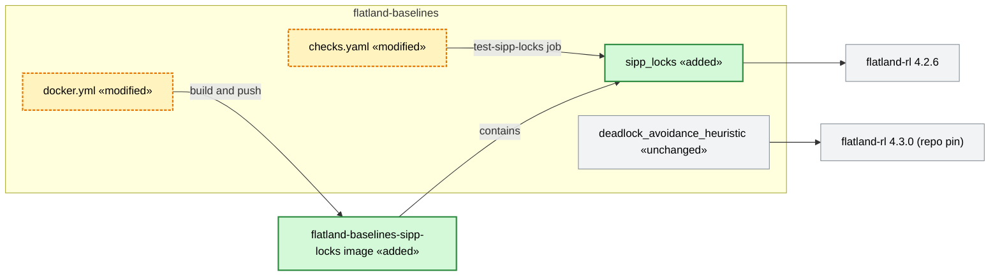

# Add the ECML 2026 winner as a baseline, first on flatland-rl 4.2.6, then on flatland pre-5.0.0 (#88)

> **Status:** plan of 2026-11-12, draft. Based on `main` `c1733cb` (release 4.3.0, pins flatland-rl 4.3.0). Issue
> [#88](https://github.com/flatland-association/flatland-baselines/issues/88) ("Add ECML 2026 winner as flatland
> baseline, update to flatland pre 5.0.0.", chenkins). Branch `88-ecml2026-winner-baseline`,
> PR [#92](https://github.com/flatland-association/flatland-baselines/pull/92). Open
> questions: §9.1 (Q-5, phase 2 only).
>
> **Why:** the ECML 2026 non-RL winner [v4-sipp-locks](https://github.com/darshanmakwana412/ecml2026) (20.8429 of 35)
> nearly doubles our best baseline (DLA, 10.7320). As a baseline it becomes the reference for later benchmarks. It
> is first added unchanged on flatland-rl 4.2.6, the competition's version, so its score can be calibrated against
> the leaderboard before the move to flatland pre-5.0.0 changes both the code and the rewards.

## 1. Introduction and goals

*What the change is for: the requirements, the qualities that matter, who has a stake, and what it leaves out.*

### 1.1 Requirements overview (functional requirements)

*The issue's text and the numbered requirements the rest of the plan refers to.*

> Add ECML 2026 winner as flatland baseline, update to flatland pre 5.0.0.
>
> (comment) https://github.com/darshanmakwana412/ecml2026

Added by chenkins on 2026-11-12: "make it 4.2.6 only in a first phase, so we can calibrate, see
[ECML 2026](https://flatland-association.github.io/flatland-book/challenges/ecml2026.html)".

Requirements:

- **REQ-1** The ECML 2026 non-RL winner (`v4-sipp-locks`, [darshanmakwana412/ecml2026](https://github.com/darshanmakwana412/ecml2026))
   is a baseline of this repo, run through the same container contract as the others (`POLICY`/`OBS_BUILDER`,
   `flatland-trajectory-generate-from-policy`).
- **REQ-2** Phase 1: it runs on flatland-rl 4.2.6 (the version the competition evaluated with), with the winner's code
   unchanged except for packaging (2026-11-12).
- **REQ-3** Phase 1: calibration. The phase-1 image reproduces the leaderboard result of submission
   [9f2952a6](https://competition.flatland.cloud/suites/6240c685-0fb4-481e-9404-47a570632227/c85d5fc2-15da-4a62-8e14-28d1261c29bd/submissions/9f2952a6-fb6b-4140-be5e-ca118baaa74e)
   (20.8429) within the tolerance of Q-3 (2026-11-12).
- **REQ-4** Its image is built and published like the other baselines.
- **REQ-5** Phase 2: the baseline runs on flatland pre-5.0.0 (flatland-rl `main` towards milestone
   [5.0.0](https://github.com/flatland-association/flatland-rl/milestone/23), due 2026-12-01) and is re-measured;
   the difference to phase 1 is explained.

### 1.2 Quality goals (non-functional requirements)

*The few qualities the design must reach, each with a concrete scenario.*

| ID | Priority | Quality goal | Scenario |
|---|---|---|---|
| NFR-1 | 1 | Fidelity | Phase 1: the image of this repo scores like the submitted `ghcr.io/darshanmakwana412/ecml2026:v4-sipp-locks` on the ECML 2026 suite (Q-3); any code difference to the submission is visible in one diff (§4.4). |
| NFR-2 | 2 | Isolation | Phase 1: the 4.2.6 pin of the new baseline changes nothing for the other baselines (still flatland-rl 4.3.0), and `pip install flatland-baselines` still pulls 4.3.0. |
| NFR-3 | 3 | Slim image | The image stays near the winner's ~0.5-0.8 GB: the evaluator gives a pod 20 minutes to start, image pull included (the winner's 7.3 GB image timed out). |

### 1.3 Stakeholders

*Who asks for the change, decides on it, reviews it or works with the result, and what they expect.*

| Role | Name | Expectations |
|---|---|---|
| Issue author, decides Q-1–Q-5 | chenkins | A calibrated strong baseline, then one on flatland 5.0.0. |
| Author of the winning solution | darshanmakwana412 | Credit, and the code kept faithful to the submission (MIT licence). |
| Benchmark users (FAB, competition organisers) | - | A reference score next to DLA, comparable to the ECML 2026 leaderboard. |

### 1.4 Follow-ups (not in this PR)

*What this PR leaves out, why, and where it goes later.*

| Follow-up | Why not in this PR | From | Findings | Issue |
|---|---|---|---|---|
| Phase 2: run on flatland pre-5.0.0 and re-calibrate (§4.6). | Second PR, after the phase-1 calibration and flatland-rl 5.0.0 (Q-4). | REQ-5, Q-4 | - | [#88](https://github.com/flatland-association/flatland-baselines/issues/88) (stays open: this PR relates to it, the phase-2 PR closes it) |
| Serve intermediate stops again once braking is no longer penalised like a collision. | The winner skips stops because flatland-rl 4.2.6 penalises a normal stop with −250·v; a reward change, not packaging. | §2.1 | - | [#88](https://github.com/flatland-association/flatland-baselines/issues/88) (phase 2) |
| Second place (`fast-first-v3`) as a baseline. | Not asked; it hardcodes the competition map. | - | - | untracked |
| Calibration in public CI. | The 35 ECML 2026 scenarios are not public. | §2 | - | untracked |

## 2. Constraints

*What limits the design from outside: platform, organisation and conventions.*

| Constraint | Kind | Explanation |
|---|---|---|
| flatland-rl 4.2.6 in phase 1 | technical | The competition supported 4.2.5 and 4.2.6; the winner's image pins `flatland-rl==4.2.6` from PyPI. |
| The repo pin stays 4.3.0 | convention | `pyproject.toml`, `environment.yml`, `checks.yaml` (`# DEPENDENCY SWITCH`, `CLAUDE.md`) pin 4.3.0 for all baselines and the PyPI package. |
| Winner's code doesn't run on 4.3.0+ | technical | It calls `ObservationBuilder.reset()` without `env` (4.3.0: `reset(env)`) and reads `agent.position`/`agent.direction`/`agent.initial_configuration` (removed in 4.3.0; on flatland-rl `main` after 4.3.0 renamed again to `agent.current_entry_point`/`agent.initial_entry_point`, commit 7599b962b). |
| MIT licence | organisational | The licence file must be kept with the code. The winner's repo kept the starterkit's `LICENSE` ("Copyright (c) 2025 Flatland Association"), so it names no other author; the README credits darshanmakwana412. |
| Evaluator contract | technical | The container is started with `flatland-trajectory-generate-from-policy ...`; `POLICY`, `OBS_BUILDER` set, CLI on `PATH`; pod start incl. pull within 20 minutes. |
| Scenarios not public | organisational | The 35 ECML 2026 envs are on the organisers' SharePoint (`flatland-ecml2026-evaluation` README); only `level_0_scenario_1.pkl` of the starterkit is public. |
| Remote git and submissions | organisational | Pushing, image publishing triggers and competition submissions are done by the user. |

### 2.1 Limitations (to be kept in `flatland_baselines/sipp_locks/README.md`)

*What the built code gets wrong or ignores, each with the TODO or issue that tracks it.*

- Runs only on flatland-rl 4.2.x (phase 1); its tests skip on other versions. Follow-up "Phase 2".
- Results depend on the machine: a wall-clock governor (`PLANNER_TIME_BUDGET_S=1200`) lowers the search budget
  when an episode runs long, so scores are not bit-identical across hardware. Q-3.
- Intermediate stops are skipped on purpose (cheaper than braking under 4.2.6 rewards). Follow-up "Serve
  intermediate stops".
- Tuned on the single ECML 2026 topology; other maps are untested here.

### 2.2 Assumptions

Not checked in code; they hold by construction of the phase-1 image and the calibration run.

- The repo's `submission/` at `efcdd89` (2026-07-07) is the code in the submitted image `v4-sipp-locks`; not checked
  against the image (CHK-1 dropped, §4.2). The calibration (REQ-3) is close to the submission's score.
- `python:3.12-slim` with `flatland-rl==4.2.6` from PyPI is the environment the submission ran in (the winner's
  `Dockerfile`).
- The organisers can still submit to the ECML 2026 suite (as for the DLA baseline `v4.2.6-beta`), on comparable
  evaluator hardware (governor, Q-3).
- `PLANNER_*` environment variables are unset in the evaluator, so the winner's defaults apply.

## 3. Context and scope (checked 2026-11-12 on `main` `c1733cb`)

*The code on the base branch that the change works in, as it is before the change, and where the change stops.*

- **Baselines:** each directory under `flatland_baselines/` is an independent baseline with its own `Dockerfile`
  (`FROM ghcr.io/flatland-association/flatland-rl:<tag>`, `pip install -e .`, `ENV POLICY`/`OBS_BUILDER`).
  `pip install -e .` would upgrade flatland-rl to 4.3.0 (`pyproject.toml`).
- **CI:** `checks.yaml` installs flatland-rl at `env.flatland-rl-ref` (`v4.3.0`) and runs only
  `deadlock_avoidance_heuristic` tests; `docker.yml` builds and pushes one image per baseline
  (`flatland-baselines-<name>:<tag>`, amd64 + arm64).
- **Winner's repo** (MIT, `efcdd89`): `submission/or_policy.py` (`PlannerObsBuilder`, `PlannerPolicy`),
  `submission/planner/{netgraph,sipp,runtime}.py` (no flatland imports, reads `env.agents`, `env._elapsed_steps`,
  `agent.position`, `agent.speed_counter`, `agent.malfunction_handler`, `agent.waypoints*`),
  `my_policy.py`/`my_observation_builder.py` (aliases), `Dockerfile` (`python:3.12-slim`, `flatland-rl==4.2.6`,
  `PYTHONPATH=/app`). Unused by the submission: `random_policy.py`, `policy_from_checkpoint.py`,
  `reinforcement_learning/`, `dev/`.
- **Calibration data:** `flatland-ecml2026-evaluation` holds the leaderboard (`9f2952a6`: 20.8429), per-scenario
  dataframes (`submission_dataframes/9f2952a6-….pkl`) and the rerun loop `stage_03_run_patched_submissions.py`
  (docker per scenario, `BaseECML2026Rewards`). 7 levels × 5 scenarios, max 35.

**Scope:** adds one baseline directory, one CI job and one image build; reads, but does not change, the repo pin
and the other baselines.

## 4. Solution strategy

*The fundamental choices and why, the rules the design follows, how it is verified, and the design of each part.*

| Quality goal | Scenario | Solution approach | Details |
|---|---|---|---|
| Fidelity | Same score as the submission | Copy the winner's code verbatim first, adapt only import paths in a separate commit; image built like the winner's. | §4.4, Q-2 |
| Isolation | Others stay on 4.3.0 | Own Dockerfile without `pip install -e .`, own CI job with 4.2.6; tests skip on other versions. | §4.5 |
| Slim image | Pod starts in time | `python:3.12-slim` + PyPI flatland-rl, copy only the baseline package. | §4.5 |

### 4.1 Design principles

*The rules the design follows, each with its decision, the concepts it reuses instead of building new ones, and what
is not new on purpose.*

- **Calibrate before changing.** Phase 1 changes nothing in the planner; every behavioural change waits for phase 2,
  so a score difference is either packaging (phase 1) or flatland (phase 2). (REQ-3)
- **Provenance in one diff.** The first commit is the winner's files byte-identical; the second only renames
  imports, so reviewers and the author can check fidelity. (Q-2)
- **The baseline owns its flatland version in phase 1.** The 4.2.6 pin lives in the baseline's `Dockerfile` and CI
  job only; the repo pin is untouched. (Q-4)
- **Same contract as the other baselines.** `POLICY`/`OBS_BUILDER` environment variables, image
  `flatland-baselines-<name>`, built by `docker.yml`. (Q-1)

Reused concepts:

| Need | Reused concept | Instead of |
|---|---|---|
| Policy interface | Winner's `PlannerPolicy(RailEnvPolicy)` and `PlannerObsBuilder` | A rewrite on `FullEnvObservation` (changes code before calibration). |
| Image for 4.2.6 | Winner's slim `Dockerfile` (`python:3.12-slim`, `flatland-rl==4.2.6`) | `FROM flatland-rl:<tag>` + `pip install -e .` (pulls 4.3.0). |
| Smoke test | `test_policy_runner.py`'s pattern (`generate_trajectory_from_policy`, `evaluation.json`) | A new runner. |
| Public test scenario | `level_0_scenario_1.pkl`, URL and `ECML2026_PKL` as in flatland-rl's `checks.yml`/`tox.ini` | Committing a scenario copy. |
| Calibration rerun | `stage_03_run_patched_submissions.py` loop in `flatland-ecml2026-evaluation` | A rerun script in this repo. |

Not new on purpose: the repo pin (4.3.0), `pyproject.toml` dependencies, the other baselines' Dockerfiles and tests,
the planner's `PLANNER_*` knobs and defaults.

### 4.2 Verification

*How each requirement and quality goal is shown to work: tests, CI checks, before and after screenshots.*

Screenshots: none, nothing visible changes. CHK-1 and CHK-2 were planned as manual checks by the user (docker, competition access); CHK-1 is dropped.

| ID | Requirement | Test or check | Result | Screenshots |
|---|---|---|---|---|
| CHK-1 | REQ-2, NFR-1 | Extract `/app/submission` from `ghcr.io/darshanmakwana412/ecml2026:v4-sipp-locks` (`flatland-ecml2026-evaluation` README, "Extract code") and `diff -r` it with the repo's `submission/` at `efcdd89`. | — Dropped by chenkins on 2026-11-13; not run. | - |
| REQ-1 | REQ-1 | `test_sipp_locks_policy_runner.py`: runs `level_0_scenario_1.pkl` through `generate_trajectory_from_policy`, asserts exit 0, all agents done, reward equals the recorded value. Also the image's contract by hand: only the files the `Dockerfile` copies, `POLICY`/`OBS_BUILDER` set, `flatland-trajectory-generate-from-policy`. | ✅ locally on flatland-rl 4.2.6, Python 3.12.13: 6 of 6 trains arrive, reward −200 (skipped stops), normalized 0.9325, the same in three runs and by hand; skipped on flatland-rl `main`. CI at 58ca384: `test-sipp-locks` 1 passed on flatland-rl 4.2.6. | - |
| REQ-2 | REQ-2 | New CI job on flatland-rl 4.2.6 green; `git diff` of S-2 against S-1 shows only imports. | S-1 files have the source's git blob SHAs; S-2 changes one import line in `or_policy.py`. ✅ CI green at 58ca384. | - |
| REQ-3 | REQ-3 | CHK-2: calibration as decided in Q-3; results table in the baseline's README (S-5). | ✅ suite submission 39f952ae on fab-int: 20.8094 vs. 20.8429 (−0.0335), completion 73.24% vs. 73.27% (−0.03 pp); five of seven levels identical, levels 4 and 6 slightly lower. Accepted by chenkins on 2026-11-13. The offline per-scenario rerun of Q-3 b was not run. | - |
| REQ-4 | REQ-4 | `docker.yml` pushes `flatland-baselines-sipp-locks:<tag>`; image size noted in the PR. | ✅ pushed at 58ca384 as `ghcr.io/flatland-association/flatland-baselines-sipp-locks:88-ecml2026-winner-baseline` (amd64, arm64). Size: 195 MB compressed for amd64, 191 MB for arm64 (registry manifests); 832 MB unpacked for arm64 (`docker image inspect`). | - |
| REQ-5 | REQ-5 | Phase 2 (§4.6). | open | - |
| NFR-2 | NFR-2 | Existing `checks.yaml` jobs unchanged and green; `pip install .` resolves flatland-rl 4.3.0. | ✅ at 58ca384: `test-dla-regression` and `test-online-offline-evaluation-demo` green on all Python versions; `pyproject.toml` unchanged. | - |
| NFR-3 | NFR-3 | Image size from the registry and `docker image inspect`. | ✅ 195 MB to pull for amd64 (191 MB for arm64), 832 MB unpacked for arm64: the size of the winner's own slim image (about 825 MB by the author's notes), not of the 7.3 GB one that timed out. Slightly above the 0.8 GB of the scenario. | - |

### 4.3 Package and naming (REQ-1; Q-1)

New baseline directory `flatland_baselines/sipp_locks/`, image `flatland-baselines-sipp-locks`, after the
submission's name `v4-sipp-locks` (SIPP = safe-interval path planning, corridor locks). README entry "🔒 SIPP with
corridor locks (ECML 2026 winner)", crediting darshanmakwana412.

### 4.4 Code import (REQ-2; Q-2)

- S-1 copies `submission/or_policy.py` and `submission/planner/{__init__,netgraph,sipp,runtime}.py` at `efcdd89`
  byte-identical, plus the winner's `LICENSE` as `LICENSE-ecml2026`. Not copied: the aliases `my_policy.py`/
  `my_observation_builder.py` (the environment variables name the classes directly), `random_policy.py`,
  `policy_from_checkpoint.py`, `reinforcement_learning/`, `dev/`.
- S-2 changes only `from submission.planner.runtime import` to `from flatland_baselines.sipp_locks.planner.runtime
  import`; the planner uses relative imports already.

### 4.5 Image and CI on flatland-rl 4.2.6 (REQ-2, REQ-4; Q-4)

- `sipp_locks/Dockerfile`: `FROM python:3.12-slim`, `pip install flatland-rl==4.2.6`, `COPY flatland_baselines/
  ...`, `ENV PYTHONPATH=/app`, `POLICY=flatland_baselines.sipp_locks.or_policy.PlannerPolicy`,
  `OBS_BUILDER=flatland_baselines.sipp_locks.or_policy.PlannerObsBuilder`. No `pip install -e .`. Ignores the
  `FLATLAND_RL_REF` build argument of `docker.yml` (phase 1).
- `checks.yaml`: job `test-sipp-locks` (ubuntu-24.04, Python 3.12), `pip install flatland-rl==4.2.6 pytest`,
  downloads `level_0_scenario_1.pkl` into `ECML2026_PKL`, runs `pytest flatland_baselines/sipp_locks/tests`.
- The tests skip unless `ObservationBuilder.reset` takes no `env` (flatland-rl 4.2.x), not by package version: flatland-rl
  can come through `PYTHONPATH` without package metadata. The DLA job does not collect
  them (it runs only `deadlock_avoidance_heuristic/tests`).

### 4.6 Phase 2: flatland pre-5.0.0 (REQ-5; Q-4)

Outline, detailed in a plan revision at the start of the phase-2 PR (checked against flatland-rl `main` `3e30f9ef` on
2026-11-13):

- `PlannerObsBuilder.reset(env)` (4.3.0 interface); `agent.position`/`agent.direction` →
  `agent.current_entry_point`, `agent.initial_configuration` → `agent.initial_entry_point`. The `*_configuration`
  names of 4.3.0 (used by DLA since #78) were renamed to `*_entry_point` on `main` after 4.3.0 (7599b962b,
  "rename Configuration/ConfigurationType to EntryPoint"). Still there on `main`: `speed_counter`,
  `malfunction_handler.malfunction_down_counter`, `waypoints*`, `_elapsed_steps`, `_max_episode_steps`, `TrainState`.
- Blocked outside this plan: flatland-baselines `main` (pinned to 4.3.0, green) does not yet run on flatland-rl
  `main`; its DLA tests fail there (`ImportError: cannot import name 'ObservationType'` from
  `flatland.core.env_observation_builder`, 6 failed and 4 errors on 2026-11-13). Moving the repo pin to 5.0.0 comes
  first; S-7 builds on it.
- Dockerfile back to the repo pattern (`FROM flatland-rl:<tag>`, `pip install -e .`, `FLATLAND_RL_PIP_URL`); tests
  join the repo pin's CI job; version skip removed.
- Re-run the calibration of Q-3 on flatland-rl 5.0.0 (or its release branch); explain differences by flatland change
  (e.g. the collision penalty for a normal stop, `fix/collision-penalty-for-normal-stop`).
- If flatland-rl 5.0.0 no longer penalises a normal stop like a collision, re-measure `PLANNER_SERVE_STOPS=1` and
  change the default if serving intermediate stops scores better (follow-up in §1.4).
- Per-level scores for the comparison come from the FAB results API:
  `https://api-fab.flatland.cloud/results/submissions/<submission id>/tests/<test ids, comma-separated>` (or
  `api-fab-int` for fab-int), with the seven ECML 2026 test IDs from `ECML2026` in
  `flatland-ecml2026-evaluation`'s `stage_00_rerun_with_detailled_rewards.py`; the totals without `/tests/...`.

## 5. Building block view

*The components the change adds or changes: an overview, why the system is split this way, what each is responsible
for, the important interfaces, and the planned data model.*

### 5.1 flatland-baselines (phase 1)

*One white box: its building blocks, why it is split this way, and the interfaces between them.*

Notation: [flowchart in Mermaid](https://mermaid.js.org/syntax/flowchart.html); green added, yellow (dashed)
modified, grey unchanged.

**Motivation:** the new baseline is a sibling directory like the others, but with its own flatland version in phase
1, so it gets its own CI job and Dockerfile (§4.1, "The baseline owns its flatland version in phase 1").

**Contained building blocks:**

| Component | Responsibility | Change |
|---|---|---|
| `sipp_locks` (`PlannerPolicy`, `PlannerObsBuilder`, `PlannerRuntime`) | Plans all trains centrally with SIPP over a shared reservation table and repairs plans each step. Not a learned policy, not generic across maps (tuned for ECML 2026). | 🟩 added: users can run and benchmark the ECML 2026 winner as a baseline. |
| `sipp_locks/Dockerfile` | Packages the baseline for the evaluator on flatland-rl 4.2.6. Not for other flatland versions in phase 1. | 🟩 added: a slim submission image like the winner's. |
| `checks.yaml` | Tests every baseline against its flatland version. | 🟨 modified: the new baseline is tested on 4.2.6. |
| `docker.yml` | Builds and publishes one image per baseline. | 🟨 modified: publishes `flatland-baselines-sipp-locks`. |
| `deadlock_avoidance_heuristic` | Existing DLA baseline. | ⬜ unchanged |

## 7. Deployment view

*Where the components run and how they are delivered, when the change touches it.*

- Image `ghcr.io/flatland-association/flatland-baselines-sipp-locks:<tag>` (amd64 + arm64), tag as for the other
  images (`latest` on `main`, branch name on PRs, input on dispatch).
- Calibration (CHK-2) runs the image on the competition evaluator (Q-3 a) and/or locally via the `stage_03` loop of
  `flatland-ecml2026-evaluation` (Q-3 b). Environment: no `PLANNER_*` variables set.

## 8. Crosscutting concepts

*What the change introduces that other code will follow, and what it changes for existing callers.*

### 8.1 New patterns

*What is new compared with the base branch.*

Compared with `main`. What is reused, and what is not new on purpose, is in §4.1.

| New | Defined in |
|---|---|
| A baseline pinned to a flatland-rl version other than the repo pin (own Dockerfile and CI job, version-gated tests). | §4.5, Q-4 |
| Third-party code vendored with its licence and an unchanged first commit. | §4.4, Q-2 |

### 8.2 Breaking changes

*What breaks for whom, and the migration path.*

None for callers: only a new package and image. Note: `pip install flatland-baselines` ships
`flatland_baselines.sipp_locks`, which fails at `reset()` under flatland-rl 4.3.0 until phase 2 (§2.1).

## 9. Decisions

*The decisions behind the plan: the questions still open, the decisions taken, and how each review finding was settled.*

### 9.1 Open questions

*Choices not made yet, each with its options and a proposal.*

✅ ~~**(Q-1) Name of the baseline?**~~ **Decided 2026-11-12:** a), `sipp_locks` / `flatland-baselines-sipp-locks`.
- a) `sipp_locks` / `flatland-baselines-sipp-locks`: after the submission `v4-sipp-locks`.
- b) `ecml2026_winner`: says where it comes from, not what it does.
- c) `sipp_heuristic`: in line with `*_heuristic`, but drops the corridor locks.

*Proposal:* a).

✅ ~~**(Q-2) How is the winner's code taken over?**~~ **Decided 2026-11-12:** a), vendored copy (S-1 byte-identical, S-2 only imports).
- a) Vendored copy: S-1 byte-identical at `efcdd89` with the licence, S-2 only imports. Self-contained, reviewable,
  updates are manual.
- b) Git submodule of the winner's repo: exact provenance, but `submission.` import paths, a submodule in the
  image build, and the repo can change or vanish.
- c) Ask the author for a PR: credit by authorship, but slower and outside our control.

*Proposal:* a), and mention the baseline to the author (user decides whether to contact them).

✅ ~~**(Q-3) How is phase 1 calibrated, and with what tolerance?**~~ **Decided 2026-11-12:** c), suite submission and offline `stage_03` rerun; passes within ±0.5 of 20.8429 total and ±2 percentage points completion rate.
- a) Submit `flatland-baselines-sipp-locks` to the ECML 2026 suite, as "Baseline: …" like DLA `v4.2.6-beta`: same
  infrastructure as 20.8429.
- b) Rerun the 35 scenarios offline with `stage_03`'s loop and compare per scenario with
  `submission_dataframes/9f2952a6-….pkl`: per-scenario diffs, but other hardware for the governor.
- c) Both.

Tolerance: the wall-clock governor makes runs machine-dependent. *Proposal:* c), passing when the suite total is
within ±0.5 of 20.8429 and the completion rate within ±2 percentage points; a larger gap is analysed per scenario
(b) before phase 2.

✅ ~~**(Q-4) Phase 2 in this PR or a second one?**~~ **Decided 2026-11-12:** b), a second PR on the same plan.
- a) This PR: one review, but it stays open until flatland-rl 5.0.0.
- b) A second PR on the same plan (§4.6): phase 1 merges once calibrated.

*Proposal:* b).

💡 **(Q-5) Which flatland-rl image tag in phase 2?** Depends on the 5.0.0 release date (milestone due 2026-12-01):
- a) `v5.0.0` once released.
- b) A pre-release branch via `FLATLAND_RL_PIP_URL`.

*Proposal:* decide at the start of phase 2; a) if released by then. Either way the repo pin moves first (§4.6,
blocker of S-7).

### 9.2 Decision log

*Every decision by date, with why it was taken and what follows from it.*

| Date | Decision | Why | Consequences |
|---|---|---|---|
| 2026-11-12 | ✅ Phase 1 only on flatland-rl 4.2.6, to calibrate; flatland pre-5.0.0 in phase 2 (REQ-2, REQ-3, REQ-5). | chenkins: separates the effect of packaging from the effect of flatland changes on the score. | Own Dockerfile and CI job with 4.2.6 (§4.5); phase 2 outline (§4.6). |
| 2026-11-12 | ✅ Name `sipp_locks`, image `flatland-baselines-sipp-locks` (Q-1, §4.3). | Follows the submission name `v4-sipp-locks` and says what it does; not `ecml2026_winner` (origin only) or `sipp_heuristic` (drops the locks). | Directory, image, README entry. |
| 2026-11-12 | ✅ Vendored copy, byte-identical first commit, imports only in the second (Q-2, §4.4). | Fidelity is checkable in one diff; no submodule (import paths, build, external repo) and no waiting for an author PR. | S-1, S-2; licence file kept; updates from upstream are manual. |
| 2026-11-12 | ✅ Calibrate by suite submission and offline `stage_03` rerun, tolerance ±0.5 total and ±2 pp completion (Q-3, §4.2). | The suite gives the comparable total, the rerun gives per-scenario diffs; the wall-clock governor rules out bit-identity. | CHK-2, S-5; a larger gap is analysed per scenario before phase 2. |
| 2026-11-12 | ✅ Phase 2 in a second PR on this plan (Q-4, §4.6). | Phase 1 can merge once calibrated; phase 2 depends on flatland-rl 5.0.0 (due 2026-12-01). | §1.4 follow-up; S-6–S-8 in the second PR. |
| 2026-11-13 | ✅ Serving intermediate stops is revisited in phase 2 under #88; the second place as a baseline and calibration in public CI stay untracked (§1.4). | Serving stops depends on the rewards phase 2 moves to. The runner-up hardcodes the competition map, and the competition's scenarios are not public. | §4.6 gets the serve-stops re-measurement; no new issues. |

### 9.3 Code Review Findings

*Findings from code reviews, PR comments and TODOs, with their status and the commits that fix them.*

PR [#92](https://github.com/flatland-association/flatland-baselines/pull/92), based on `main` `c1733cb`, checked at `f4c85c8` on 2026-11-12: no review or conversation comments and no TODOs added, so no findings.

## 10. Glossary

*The domain and technical words the plan uses, with their code symbols.*

- **SIPP** (`SippPlanner`, `planner/sipp.py`): safe-interval path planning, a time-aware A* over intervals in which a
  cell is free. Not flatland's k-shortest-paths.
- **Corridor lock** (`LOCK_MIN_LEN=20`): a reservation of a long single-track section in one direction for a time
  window, so opposing trains are scheduled after. Not a flatland concept.
- **Wall-clock governor** (`PLANNER_TIME_BUDGET_S`): lowers replanning effort after 1200 s of an episode. Source of
  machine-dependent results.
- **Calibration**: showing that this repo's image reproduces the leaderboard score of submission `9f2952a6`. Not
  tuning.
- **Phase 1 / phase 2**: flatland-rl 4.2.6 unchanged code / flatland pre-5.0.0 adapted code.
- **flatland pre-5.0.0**: flatland-rl `main` after `v4.3.0`, towards milestone 5.0.0.

## 11. Execution plan and status

*The commits that build the change, in order, and which of them are done: the source of the PR's status.*

### 11.1 Steps

*One row per commit: what it does, the findings it fixes, its message, and its SHAs once committed.*

#### Phase 1: the winner on flatland-rl 4.2.6, calibrated ✅

| ID | Findings | Step | Category | Severity | Commit message | Commit(s) | Needs | Blocked by |
|---|---|---|---|---|---|---|---|---|
| ✅ S-1 | - | Copy the winner's planner and policy byte-identical at `efcdd89`, with its licence. | feature | - | `feat(sipp-locks): import ECML 2026 winner v4-sipp-locks unchanged from darshanmakwana412/ecml2026@efcdd89.` | 80124cb | - | - |
| ✅ S-2 | - | Package it: imports, `Dockerfile`, README (provenance, limitations), smoke test, repo README and `CLAUDE.md` entries. | feature | - | `feat(sipp-locks): run v4-sipp-locks as baseline on flatland-rl 4.2.6.` | 2172dfb | S-1 | - |
| ✅ S-3 | - | CI job `test-sipp-locks` on flatland-rl 4.2.6. | ci | - | `ci(sipp-locks): test the sipp-locks baseline against flatland-rl 4.2.6.` | 2df6edb | S-2 | - |
| ✅ S-4 | - | Build and push the image in `docker.yml`. | ci | - | `ci(docker): build and push the sipp-locks baseline image.` | 58ca384 | S-2 | - |
| ✅ S-5 | - | Record the calibration (CHK-2) in the baseline's README. | docs | - | `docs(sipp-locks): record calibration against the ECML 2026 leaderboard.` | 26f5fe2 | S-4 | - |

#### Phase 2: flatland pre-5.0.0 (second PR, Q-4) 💡

| ID | Findings | Step | Category | Severity | Commit message | Commit(s) | Needs | Blocked by |
|---|---|---|---|---|---|---|---|---|
| 💡 S-6 | - | Adapt to `ObservationBuilder.reset(env)` and `agent.current_entry_point`/`initial_entry_point`. | refactor | - | `refactor(sipp-locks): adapt to the flatland-rl pre-5.0.0 interfaces.` |  | S-5 | Q-5 |
| 💡 S-7 | - | Dockerfile and CI back to the repo pin; drop the version skip. | build | - | `build(sipp-locks): build and test on the repo's flatland-rl pin.` |  | S-6 | the repo pin on flatland-rl 5.0.0 (§4.6) |
| 💡 S-8 | - | Re-calibrate and explain the difference to phase 1. | docs | - | `docs(sipp-locks): record calibration on flatland-rl 5.0.0.` |  | S-7 | - |

## 12. Change inventory

*Every file the change adds, modifies, renames or removes, and what stays unchanged on purpose.*

Phase 1; phase 2 is listed at the start of the phase-2 PR.

### 12.1 New files

*The files the change adds, and what each adds.*

| File | Adds |
|---|---|
| `flatland_baselines/sipp_locks/__init__.py` | Package marker. |
| `flatland_baselines/sipp_locks/or_policy.py` | `PlannerPolicy`, `PlannerObsBuilder` (winner's, import path changed in S-2). |
| `flatland_baselines/sipp_locks/planner/{__init__,netgraph,sipp,runtime}.py` | `NetGraph`, `SippPlanner`, `Reservations`, `PlannerRuntime` (winner's, unchanged). |
| `flatland_baselines/sipp_locks/LICENSE-ecml2026` | The winner's repo's MIT licence file (from the starterkit). |
| `flatland_baselines/sipp_locks/README.md` | Provenance (repo, commit, submission, score), how to run, `PLANNER_*` knobs, limitations (§2.1), calibration (S-5). |
| `flatland_baselines/sipp_locks/Dockerfile` | Slim image on flatland-rl 4.2.6 (§4.5). |
| `flatland_baselines/sipp_locks/tests/{__init__,test_sipp_locks_policy_runner}.py` | Smoke test on `level_0_scenario_1.pkl` with `ECML2026Rewards`, skipped unless flatland-rl 4.2.x and `ECML2026_PKL` set. |

### 12.2 Modified files

*The files the change modifies, and what changes in each.*

| File | Changes |
|---|---|
| `.github/workflows/checks.yaml` | Job `test-sipp-locks` (S-3). |
| `.github/workflows/docker.yml` | Build step for `flatland-baselines-sipp-locks` (S-4). |
| `README.md` | "Baselines provided" entry with credit (S-2). |
| `CLAUDE.md` | `sipp_locks` in "Baselines layout"; its own 4.2.6 pin as exception to "The flatland-rl version pin" (S-2). |

Unchanged on purpose: `pyproject.toml`, `environment.yml`, `env.flatland-rl-ref`, the other baselines and their
Dockerfiles.
